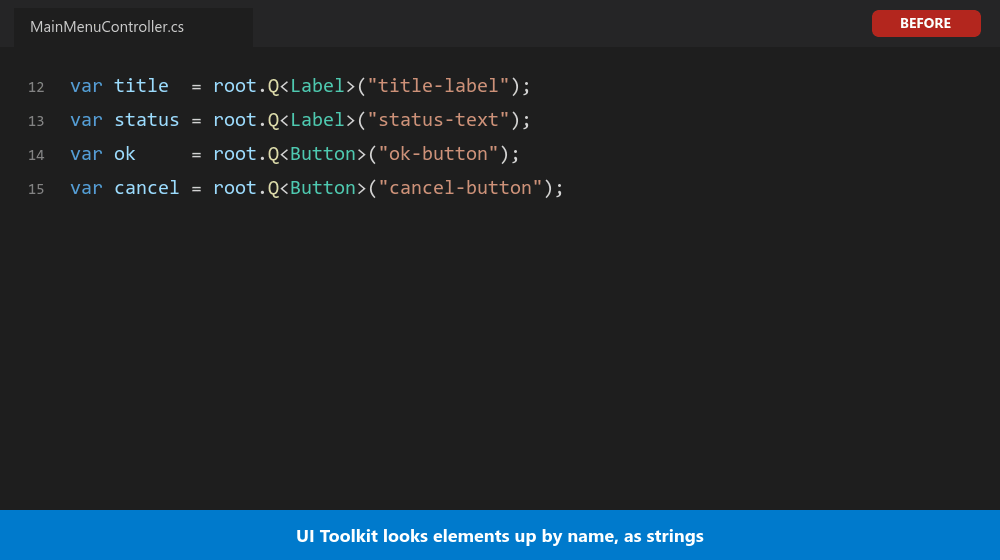

# Clever Clogs

Typed element access for Unity UI Toolkit. It knows all your UXML elements.



**Version**: 1.0.0  
**Unity Version**: 2022.1+ (developed on Unity 6000.5)  
**Namespace**: `DADC.Clogs`

## Overview

Clever Clogs is a Unity Editor extension that replaces the string literals used to look up UI Toolkit elements with generated code. It scans a UXML file for named elements and writes a helper class containing an enum of those names and a typed property for each element.

## Quick Start

1. **Open the Tool**: Navigate to `DADCTools > Clever Clogs` in Unity's menu bar
2. **Scan Your Project**: Click the "Scan" button to discover all UXML files
3. **Select a File**: Choose a UXML file from the dropdown menu
4. **Choose Elements**: Untick any named elements you don't want in the helper class
5. **Generate**: Click "Generate" to write the helper class to the output folder
6. **Carry on**: From then on the class is regenerated whenever you save the UXML file

## Generated Code

For a UXML file containing `<ui:Button name="ok-button" />`, the helper class lets you replace this:

```csharp
Button ok = root.Q<Button>("ok-button");
```

with either of these:

```csharp
// Typed property, queried once in the constructor
var ui = new DialogueWindowUXML(root);
Button ok = ui.OkButton;

// Enum instead of a string literal
Button ok = DialogueWindowUXML.Q<Button>(root, DialogueWindowUXML.Element.OkButton);
```

See the [User Guide](Documentation/User-Guide.md) for the full shape of a generated class.

## Key Features

- **UXML File Discovery**: Automatically scan and locate all VisualTreeAsset files
- **Configurable Search Paths**: Define custom folders to search for UXML files
- **Element Analysis**: List the named elements in a UXML file with their types
- **Helper Generation**: Generate a class with an enum of element names and a typed property per element
- **Auto-Regeneration**: Generated classes are kept up to date when their UXML file is saved
- **Project Settings**: Persistent configuration through ScriptableObject settings

## Documentation Structure

- [User Guide](Documentation/User-Guide.md) - Complete usage instructions
- [Architecture](Documentation/Architecture.md) - System design and patterns
- [Core Components](Documentation/Core-Components.md) - Main classes and components
- [API Reference](Documentation/API-Reference.md) - Complete API documentation
- [Data Models](Documentation/Data-Models.md) - ScriptableObjects and structs
- [Helper Utilities](Documentation/Helper-Utilities.md) - Utility class reference
- [Optimization Suggestions](Documentation/OPTIMIZATION-SUGGESTIONS.md) - Known issues and improvements

## Technical Requirements

- **Unity Version**: 2022.1+ (the element list uses `MultiColumnTreeView`); the automated tests pass on Unity 2022.3 and 6000.5, and the editor window has only been used on 6000.5
- **C# Version**: 9.0
- **.NET Target**: .NET Framework 4.7.1
- **Editor Only**: This is an Editor extension, not for runtime use

## Installation

Clever Clogs is a Unity package named `com.dannyarnold.clever-clogs`. Install it one of these ways, then open it from `DADCTools > Clever Clogs`.

**From a git URL**

1. Open `Window > Package Manager`
2. Click `+`, then "Add package from git URL..."
3. Enter:

```
https://github.com/dannyarnoldcom/CleverClogs.git?path=Assets/Imported/CleverClogs
```

**From OpenUPM**, once the package is listed there:

```
openupm add com.dannyarnold.clever-clogs
```

**By copying the folder**

1. Copy the `Assets/Imported/CleverClogs` folder from this repository to anywhere under your project's `Assets` folder
2. Wait for Unity to compile the scripts

The first time the window opens it creates `Assets/CleverClogsSettings.asset`, which holds your settings and the record of generated classes. Commit it with your project.

## Project Structure

```
CleverClogs/
├── Editor/
│   ├── CleverClogsWindow.cs       # Main editor window
│   ├── BasePanel.uxml             # Base layout structure
│   ├── SettingsPanel.uxml         # Settings interface
│   ├── CleverClogs.uxml           # Main panel layout
│   ├── CleverClogs.uss            # Styling definitions
│   └── Helpers/
│       ├── PathScan.cs            # Asset scanning utilities
│       ├── UXMLScan.cs            # UXML parsing
│       ├── SortElements.cs        # Element organization
│       ├── Generate.cs            # Helper class generation
│       ├── Regenerator.cs         # Keeps generated classes up to date
│       ├── UxmlPostprocessor.cs   # Triggers regeneration on UXML save
│       ├── ProjectSettingSO.cs    # Settings storage
│       └── [Other helpers]
├── Tests/
│   └── Editor/                     # EditMode tests and fixtures
├── Templates/                      # UXML templates (optional)
├── package.json                    # Unity package manifest
├── README.md                       # Short package readme
└── LICENSE.md                      # MIT licence
```

## License

Clever Clogs is released under the [MIT License](LICENSE).

The classes the tool generates are yours. They are not covered by this licence and carry no restrictions.

## Contributing

See [CONTRIBUTING.md](Documentation/CONTRIBUTING.md) for contribution guidelines.

## Support

[Join my Patreon for support](https://patreon.com/dannyarnold)

Clever Clogs is free and open source. Bug reports and contributions are welcome through the project repository.

---

**Namespace**: DADC.Clogs  
**Last Updated**: October 2026
